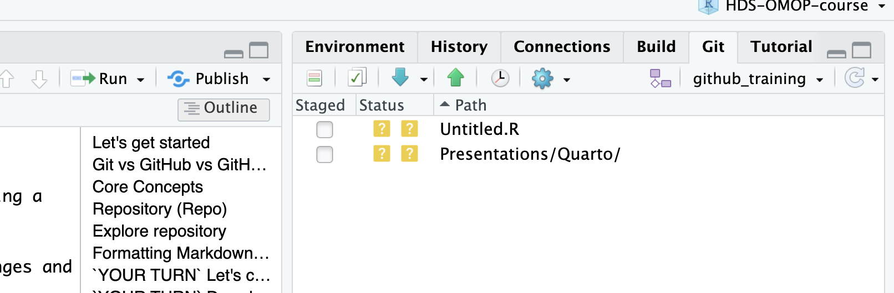

## Let's get started

We have saved an R script. Now let's practise keeping a history of a file and reviewing someone else's changes.

- Sign in to **GitHub in your browser** and **GitHub Desktop**.
- Share your username and accept your invitation to **oxford-pharmacoepi**.
- The trainer will help check that you and your reviewer can access each other's practice repositories.

We will create a separate folder called **hds-git-yourusername**. Keep your **r-introduction** project for the later sessions.

## Git vs GitHub vs GitHub Desktop

. . .

**Git** records versions of files on your computer. We can see what changed and return to earlier versions.

. . .

**GitHub** stores a shared copy online. We use its website to discuss work and review changes.

. . .

**GitHub Desktop** is the app we will use to send and receive changes using buttons.

## Which window should I use?

| Task | Where? |
|------|--------|
| Edit a script or CSV | RStudio or a text editor, then save the file. |
| Check changed files, commit, push, or pull | GitHub Desktop. |
| Open an issue, discuss a change, or review a pull request | GitHub in your browser. |

**Local** means on your computer. **Remote** means the shared copy on GitHub. Saving a file locally does not automatically send it to GitHub.

# Core Concepts

## Repository (Repo)

A repository, or **repo**, is a folder with Git tracking enabled. It holds the files we choose to track and the history of their committed changes.

An R Project helps RStudio organise your work. A Git repository records its history. A folder can be both, but they do different jobs.

{fig-align="center"}

## Explore repository

<https://github.com/oxford-pharmacoepi/Tidy-R-programming-with-OMOP>

. . .

A `README.md` is a useful front page for a repository. It can include:

-   A summary of the repository.
-   Instructions for installing a package, running code, or using a tool.
-   An overview of the repository folders.
-   How to contribute.
-   License information.
-   Acknowledgments.
-   Contact details.
-   Citation information.

## Formatting Markdown files

You can use Markdown syntax to format a text file:

-   `#` to add a heading.
-   `---` on its own line to add a horizontal rule.
-   `-` for bullet points.
-   `*text*` for italic text.
-   `**text**` for bold text.

## `YOUR TURN` Let's create a repo in *oxford-pharmacoepi*

1.  In GitHub Desktop, choose **File → New Repository…**

2.  Name it **hds-git-yourusername**, replacing `yourusername` with your own. Save it beside your R project, select **Initialize this repository with a README**, and click **Create Repository**.

The repository now exists on your computer only.

3.  Click **Publish repository**. Choose **oxford-pharmacoepi** from the organisation menu, keep the repository private, and click **Publish Repository**.

Open it on GitHub. Ask the trainer to help give your reviewer write access if they do not already have it. Being in the organisation does not always give access to every repository.

## `YOUR TURN` Download the codelist

Go to the course website's [Downloads](../../Downloads/index.qmd) tab and choose your GitHub username.

- Click **Download codelist** and save the CSV inside **hds-git-yourusername**.
- In GitHub Desktop, choose that repository and look at **Changes**.
- Open the CSV in RStudio's text editor and look at the column names.

## What are we reviewing?

A **codelist** lists concept IDs and their descriptions. Our practice files contain some deliberately wrong rows, including a concept name starting with `FAKE`.

For today's GitHub exercise, ask your reviewer to remove the **FAKE** row and explain the change. Keep the header and the remaining columns as they are.

You can edit this CSV as text: remove the whole row and save the file. The deeper question of which real concepts belong in a clinical codelist is for Day 2.

## Commit

A **commit** records a version of the changes you choose to include. Give it a short message so someone else can understand what you did.

- Every commit has an ID, an author, a time, and a message.

-   Commits are created *locally* with Git.

## `YOUR TURN` Create a commit with the codelist

1. In GitHub Desktop's **Changes** tab, tick the codelist file and inspect its contents.
2. Write `Add practice codelist` in the **Summary** field and click **Commit to main**.

-   The commit is still **local**. It will appear on GitHub after you push it.

## Push & Pull

These are the actions used to synchronise your local Git repository with the remote repository on GitHub:

-   **Push:** Send your committed changes from your computer to the remote repository on GitHub.

-   **Pull:** Fetch changes from GitHub and integrate them into your current local branch. We will practise this later.

. . .

{fig-align="center"}

## `YOUR TURN` Push to GitHub

- Click **Push origin** in GitHub Desktop.

- Refresh the repository page in your browser. The codelist should now be there.

Remember the three steps: **save the file → commit the change → push it to GitHub**.

## Issues

. . .

An **issue** is a place to track a task, bug, or idea. It gives the team a place to discuss the work, assign responsibility, and keep track of progress.

. . .

{fig-align="center"}

## Issues

-   **Labels**: Labels are tags used to categorise and organise issues by topic, priority, or status.

-   **Assignee**: The assignee is the person responsible for handling or resolving the issue.

-   **Type**, when available: describes the issue as a bug, feature, or task.

## `YOUR TURN` Open an issue

1. On your repository's GitHub page, open **Issues → New issue**.
2. Give it a title such as `Remove the fake concept from my codelist` and describe the change you want.
3. Your Downloads tab names your reviewer. Mention them with `@username` and assign the issue to them if they are available in the list.

If they cannot open the repository or appear as an assignee, ask the trainer to check access. An issue describes the work; it does not change the CSV itself.

## Inbox

Check your GitHub notifications for the request to review a colleague's codelist. If the notification has not arrived, ask them to share the issue link.

You will do two jobs: review someone else's file, then review the change someone proposes to your own file. The two colleagues may be different people.

## Clone

**Clone** means download a repository and its history to your computer. In GitHub Desktop, choose **File → Clone Repository…** and select your colleague's repository or paste its URL.

Choose a folder beside your own practice repository. Check **Current repository** before editing so you are working on your colleague's file.

. . .

{fig-align="center" height="250px"}

. . .

{fig-align="center" height="250px"}

## Branch

A **branch** lets us work on a proposed change before it is added to the main version.

-   The default and main line of development is typically called the **main** branch.

- In GitHub Desktop, use **Current branch → New branch**. Name it `review_codelist`.

. . .

{fig-align="center" height="150px"}

{fig-align="center" height="150px"}

{fig-align="center" height="50px"}

## Fork

A **fork** is a copy of a repository in your GitHub account. You can propose changes from it with a pull request when the repository's permissions allow this.

For this exercise, we will use write access to each other's repositories and work on branches. Private organisation repositories may not allow forks, so ask for help with access rather than assuming you can fork one.

## Pull Request (PR)

A **pull request (PR)** proposes changes from one branch to another, usually so the team can discuss and review them before merging.

-   PRs are where discussion, code review, and automated testing happen before the code is integrated.

## Our first PR

{fig-align="center"}

. . .

{fig-align="center"}

## `YOUR TURN` Complete your review

1.  Clone your colleague's repository once you have write access.

2.  Create a branch (for example, `review_codelist`).

3.  Remove the agreed **FAKE** row from their CSV and save the file.

4.  Commit your changes.

5.  Click **Publish branch** for its first push, or **Push origin** if it is already published.

6.  Click **Create Pull Request** and target `main` in your colleague's repository. Check the changed lines before submitting it.

7.  Describe your change and add `Closes #1`, replacing `1` with the issue number in that repository.

8.  Ask the colleague who assigned the review to review your pull request.

## Merge

A **merge** integrates changes from one branch into another. Once a pull request is approved, a repository maintainer can merge it into the target branch.

-   Let's merge your **Pull Requests**

## `YOUR TURN` Review and merge

Open the pull request **in your own repository** and look at **Files changed**. Does it remove the row you asked for, while keeping the header and other rows?

Leave a comment or approve the change. If something needs correcting, request changes and let the author update their branch. Merge once you both agree it is ready.

## `YOUR TURN` Bring the change back to your computer

The merge happened on GitHub. Now update your local copy:

1. In GitHub Desktop, select **your own repository** and switch to **main**.
2. Click **Fetch origin**, then **Pull origin** if changes are available.
3. Open your local CSV and check that the fake row has gone.

**Fetch** checks for remote updates. **Pull** brings those changes into your local branch. Start a new branch from an up-to-date `main` for your next change.

## Core exercise complete

You have saved, committed, pushed, reviewed, merged, and pulled a change. That is the workflow we will use again with OmopStudyBuilder.

The next slides are reference material and extra practice. We can return to them when we need them.

## Optional reference: Git commands

**Git**

::: small-text
| Command                       | Description                                |
|-------------------------------|--------------------------------------------|
| `git init`                    | Create a new local repository.             |
| `git clone <url>`             | Copy a remote repository locally.          |
| `git remote add origin <url>` | Add a new remote repository.               |
| `git status`                  | Check status of changes and branch.        |
| `git add <file>`              | Stage specific file(s) for commit.         |
| `git commit -m "message"`     | Commit staged changes.                     |
| `git log`                     | View commit history.                       |
| `git diff`                    | Show unstaged changes.                     |
| `git branch <name>`           | Create a new branch.                       |
| `git checkout <branch>`       | Switch to a branch.                        |
| `git merge <branch>`          | Merge another branch into the current one. |
| `git fetch`                   | Download updates from remote (no merge).   |
| `git pull`                    | Fetch and merge changes from remote.       |
| `git push`                    | Push local commits to remote.              |
| `git revert <commit>`         | Revert a specific commit with a new one.   |
:::

. . .

**GitHub Desktop** provides a graphical interface for working with Git and GitHub.

## Workflow

{fig-align="center"}

## Need to update

{fig-align="center"}

## Update from main

{fig-align="center"}

## Update from main

- First switch to `main`, then **Fetch origin** and **Pull origin**.
- Switch back to your working branch.
- Choose **Branch → Update from main**, then push your branch.

. . .

{fig-align="center" height="500px"}

## .gitignore

. . .

The `.gitignore` file lists files and folders that Git should leave untracked, such as local R session files or generated outputs.

-   To ignore a file, add its name, for example `my_file.txt`.

-   To ignore a folder, add its name followed by a slash, for example `folder/`.

-   Use patterns such as `*.txt` to ignore all `.txt` files.

It does not remove files that Git already tracks. Before committing, look at the file list; real patient data and passwords do not belong in this exercise repository.

## Merge conflicts

{fig-align="center"}

## Merge conflicts

{fig-align="center"}

## Merge conflicts

A **merge conflict** happens when Git cannot automatically combine overlapping changes. Conflicts can be resolved; they are a normal part of working together.

-   Keep pull requests focused and reasonably small.

-   Update your branch from `main` regularly, especially before opening a pull request.

-   If GitHub Desktop reports a conflict, review the conflicting changes and ask for help if you are unsure how to resolve them.

## Link a pull request to an issue

To link an issue and close it when the pull request is merged into the repository’s default branch, put one of these keywords followed by the issue number in the pull request description:

-   `close #12` / `closes #12`
-   `resolve #12` / `resolves #12`
-   `fix #12` / `fixes #12`

. . .

To link an issue without using a closing keyword, link it manually from the **Development** section of the pull request sidebar.

## Templates

. . .

Templates can be used to create new repositories:

{fig-align="center"}

## GitHub on the server

On RStudio Server, the files live on the server. GitHub Desktop on your laptop does not manage that copy directly, so use RStudio's **Git** pane there.

. . .

First, set up GitHub access on the server with the trainer, using this [tutorial](https://github.com/oxford-pharmacoepi/ServerOnboarding/blob/main/2_SettingUp/Using%20Github%20with%20RStudio%20server.pdf).

. . .

The same ideas apply: edit, save, commit, push, and pull. The buttons are in the Git pane:

{fig-align="center"}

## Clean up the practice repo

Once **both reviews are finished** and the trainer confirms the exercise is complete, delete only the temporary **hds-git-yourusername** repository:

- On GitHub, open that repository's **Settings → Danger Zone → Delete this repository** and follow the confirmation steps.

Keep **r-introduction** for Quarto and OmopViewer. Later we will create a separate **hds-study-yourusername** repository with OmopStudyBuilder.

## You are ready

. . .

{fig-align="center"}
