## Let's get started

Does everyone have a *GitHub* username?

- Share your GitHub username please :)

- Have you been added to *oxford-pharmacoepi* organisation?

## Git vs GitHub vs GitHub Desktop

. . .

**Git** is a distributed version control system that tracks changes in source code during software development and allows multiple developers to collaborate efficiently.

. . .

**GitHub** is a web-based platform that provides hosting for Git repositories, along with collaborative features like issue tracking, pull requests, and project management.

. . .

**GitHub Desktop** is a graphical user interface (GUI) application that simplifies the interaction with Git and GitHub, allowing users to perform common repository operations without using the command line.

# Core Concepts

## Repository (Repo)

A repository is essentially a **project's folder**. It contains all the project files, including code, documentation, images, and, most importantly, the **entire history** of every change made to those files.

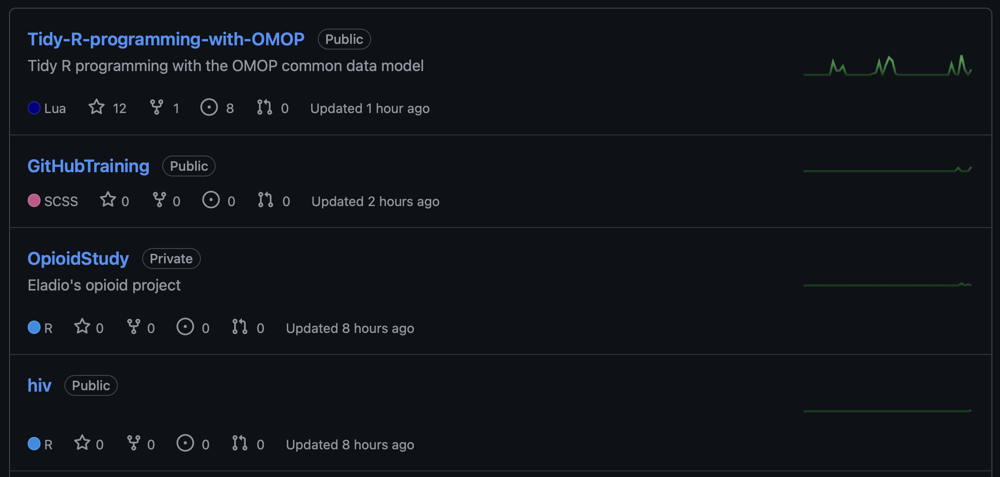{fig-align="center"}

## Explore repository

<https://github.com/oxford-pharmacoepi/Tidy-R-programming-with-OMOP>

. . .

A `README.md` is a useful front page for a repository. It can include:

- A summary of the repository.
- Instructions for installing a package, running code, or using a tool.
- An overview of the repository folders.
- How to contribute.
- License information.
- Acknowledgments.
- Contact details.
- Citation information.

## Formatting Markdown files

You can use Markdown syntax to format a text file:

- `#` to add a heading.
- `---` on its own line to add a horizontal rule.
- `- ` for bullet points.
- `*text*` for italic text.
- `**text**` for bold text.

## `YOUR TURN` Let's create a repo in *oxford-pharmacoepi*

1. In GitHub Desktop, choose **File → New Repository…**

2. Give the repository a name, choose where to save it, and click **Create Repository**.

The repository now exists on your computer only.

3. Click **Publish repository**. In the dialog, choose **oxford-pharmacoepi** from the organization menu, then click **Publish Repository**.

You now have a repository on GitHub. Open it on the website and have a look around.

## `YOUR TURN` Download the codelist

Now go to the [Downloads](https://oxford-pharmacoepi.github.io/HDS-OMOP-course/Downloads) section of the course website and look for your username.

- Download the codelist assigned to you.

- Add it to the folder of your repo

- Let's see the changes

## Commit

A **commit** is a snapshot of your repository at a specific point in time. Commits are the building blocks of Git history.

- Every commit has a unique ID (SHA), an author, a timestamp, and a **commit message** that explains *why* the change was made.

- Commits are created *locally* with Git.

## `YOUR TURN` Create a commit with the codelist

- Add a message and click commit.

- The commit is still **local**. It will appear on GitHub after you push it.

## Push & Pull

These are the actions used to synchronise your local Git repository with the remote repository on GitHub:

* **Push:** Send your committed changes from your computer to the remote repository on GitHub.

* **Pull:** Fetch changes from GitHub and integrate them into your current local branch. We will practise this later.

. . .

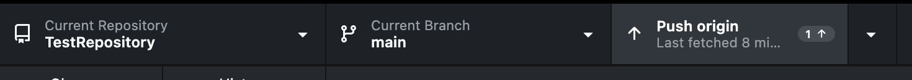{fig-align="center"}

## `YOUR TURN` Push to GitHub

- Push your changes to GitHub

- Now you should see that the codelist appears in the GitHub website

## Issues

. . .

An **issue** is a place to track a task, bug, or idea. It gives the team a place to discuss the work, assign responsibility, and keep track of progress.

. . .

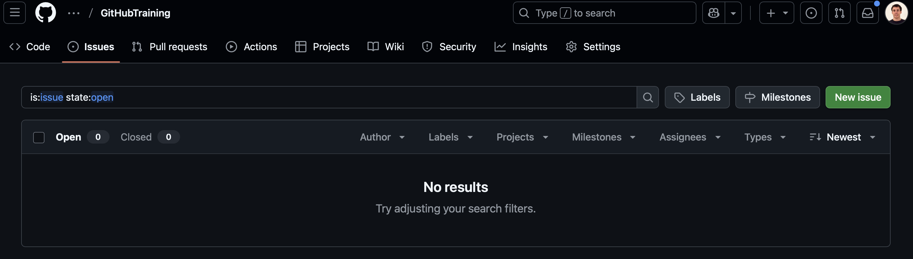{fig-align="center"}

## Issues

- **Labels**: Labels are tags used to categorise and organise issues by topic, priority, or status.

- **Assignee**: The assignee is the person responsible for handling or resolving the issue.

- **Type**: The type describes the issue, for example a *bug*, *feature request*, or *task*.

## `YOUR TURN` Open an issue

- Open an issue in your repo (you need to do that from the GitHub website)

- Ask a colleague to review your codelist. The Downloads page lists who you should ask. Tag that person in the issue and assign the issue to them.

## Inbox

Check your GitHub inbox for the request to review a colleague’s codelist. Open the request and follow the link to the issue or pull request.

## Clone

Clone a repository to make a local copy on your computer. To make a copy in your GitHub account, fork the repository.

. . .

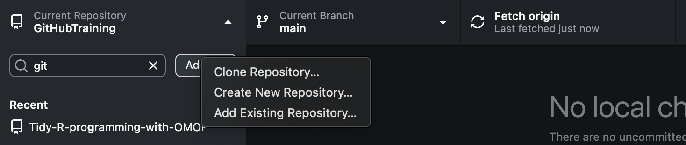{fig-align="center" height="250px"}

. . .

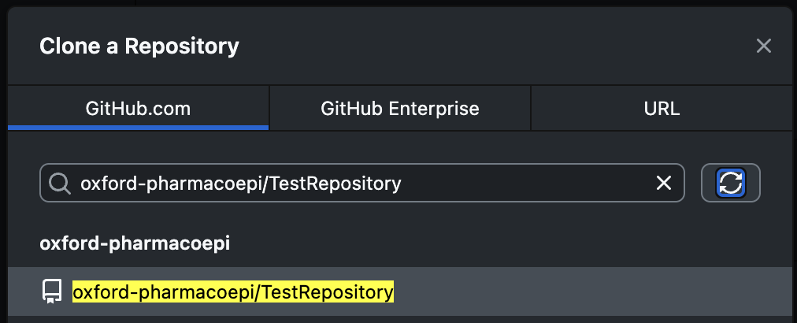{fig-align="center" height="250px"}

## Branch

A **branch** is an independent line of development.

- The default and main line of development is typically called the **main** branch.

- Branches allow developers to work on new features or bug fixes in **isolation** without affecting the stable, main code.

. . .

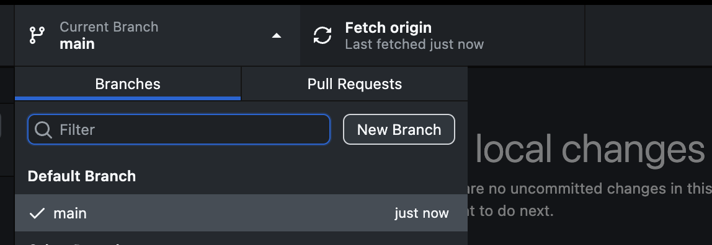{fig-align="center" height="150px"}

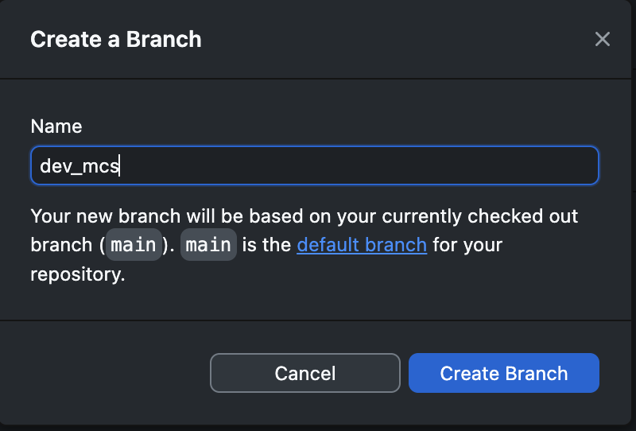{fig-align="center" height="150px"}

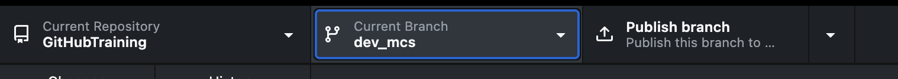{fig-align="center" height="50px"}

## Fork

A **fork** is a copy of a repository in your GitHub account. You can change your fork without changing the original, then propose your changes to the original project with a pull request. A fork is useful when you do not have write access to the original repository.

## Pull Request (PR)

A **pull request (PR)** proposes changes from one branch to another, usually so the team can discuss and review them before merging.

- PRs are where discussion, code review, and automated testing happen before the code is integrated.

## Our first PR

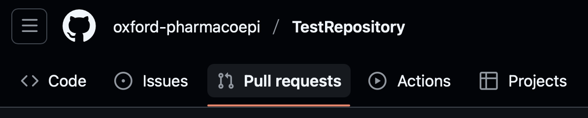{fig-align="center"}

. . .

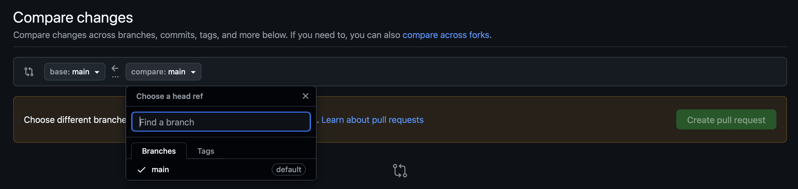{fig-align="center"}

## `YOUR TURN` Complete your review

1. Clone your colleague’s repository if you have write access. If you do not, fork it and clone your fork.

2. Create a branch (for example, `review_codelist`).

3. Review the codelist and make the agreed changes.

4. Commit your changes.

5. Push your branch to GitHub.

6. Open a pull request targeting your colleague’s repository.

7. Link the pull request to the relevant issue.

8. Ask the colleague who assigned the review to review your pull request.

## Merge

A **merge** integrates changes from one branch into another. Once a pull request is approved, a repository maintainer can merge it into the target branch.

- Let's merge your **Pull Requests**

## `YOUR TURN`

Review the pull request in your repository. Approve it or request changes, then merge it once you and the author agree it is ready.

## How everything works

**Git**

::: {.small-text}
| Command | Description |
|----------|--------------|
| `git init` | Create a new local repository. |
| `git clone <url>` | Copy a remote repository locally. |
| `git remote add origin <url>` | Add a new remote repository. |
| `git status` | Check status of changes and branch. |
| `git add <file>` | Stage specific file(s) for commit. |
| `git commit -m "message"` | Commit staged changes. |
| `git log` | View commit history. |
| `git diff` | Show unstaged changes. |
| `git branch <name>` | Create a new branch. |
| `git checkout <branch>` | Switch to a branch. |
| `git merge <branch>` | Merge another branch into the current one. |
| `git fetch` | Download updates from remote (no merge). |
| `git pull` | Fetch and merge changes from remote. |
| `git push` | Push local commits to remote. |
| `git revert <commit>` | Revert a specific commit with a new one. |
:::

. . .

**GitHub Desktop** provides a graphical interface for working with Git and GitHub.

## Workflow

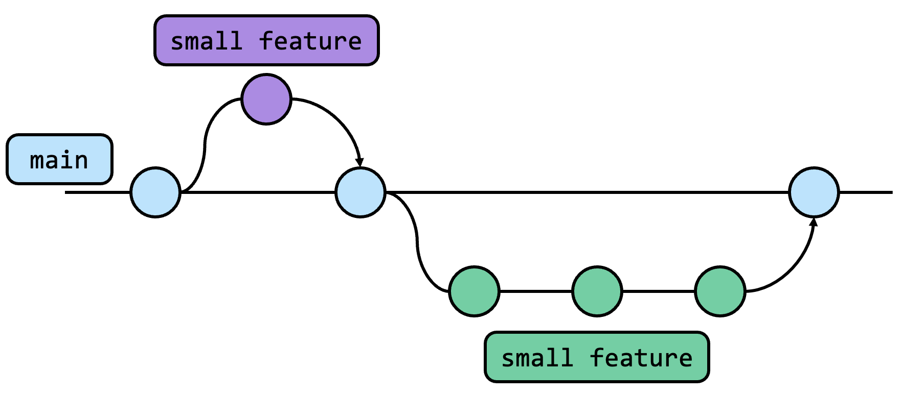{fig-align="center"}

## Need to update

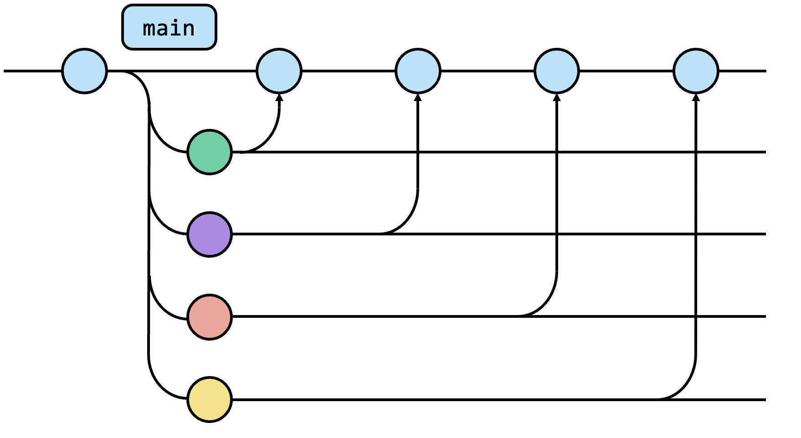{fig-align="center"}

## Update from main

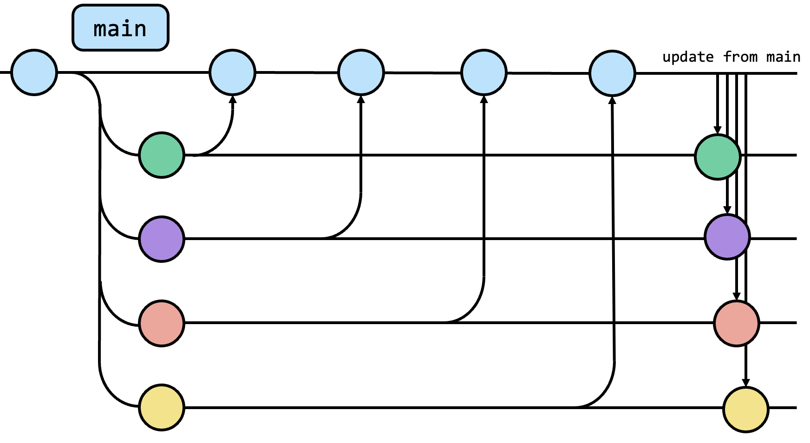{fig-align="center"}

## Update from main

- Change to `your_branch` branch

- `Branch` > `Update from main`

- `Push`

. . .

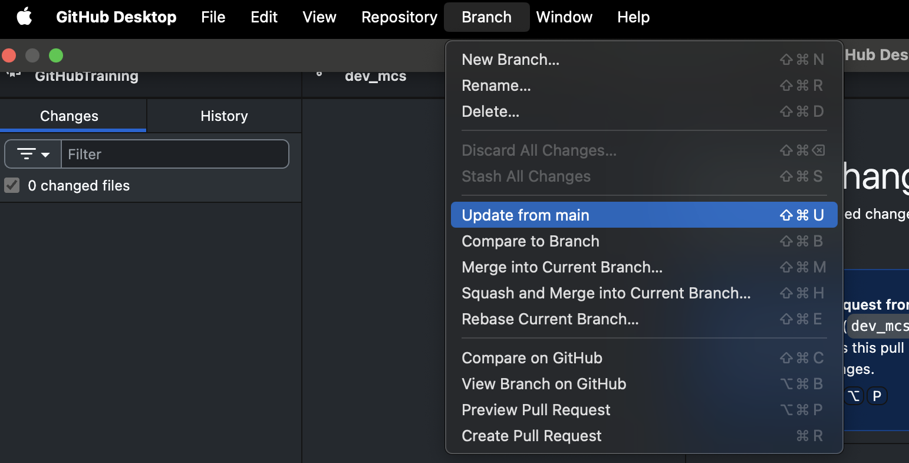{fig-align="center" height="500px"}

## .gitignore

. . .

The `.gitignore` file tells **git** which files or folders to skip when tracking changes. It prevents temporary, sensitive, or unnecessary files from being added to a repository. Common examples include log files, build artifacts, and environment files. This keeps the repo clean and focused on essential code and assets.

- To ignore a file, add its name, for example `my_file.txt`.

- To ignore a folder, add its name followed by a slash, for example `folder/`.

- Use patterns such as `*.txt` to ignore all `.txt` files.

## Merge conflicts

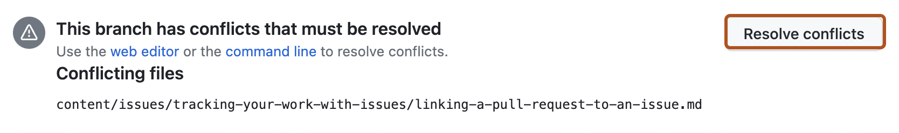{fig-align="center"}

## Merge conflicts

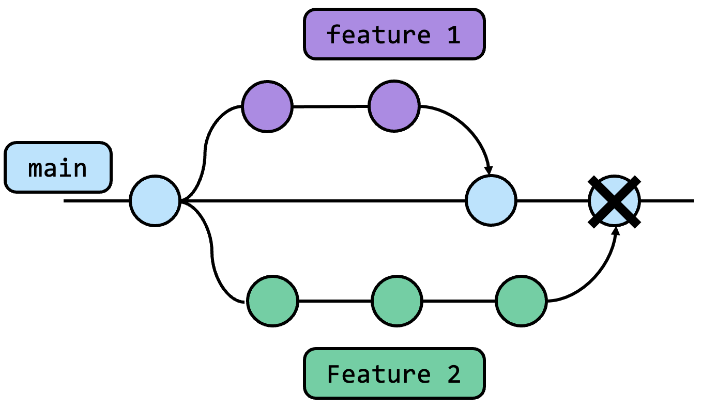{fig-align="center"}

## Merge conflicts

A **merge conflict** happens when Git cannot automatically combine overlapping changes. Conflicts can be resolved; they are a normal part of working together.

- Keep pull requests focused and reasonably small.

- Update your branch from `main` regularly, especially before opening a pull request.

- If GitHub Desktop reports a conflict, review the conflicting changes and ask for help if you are unsure how to resolve them.

## Link a pull request to an issue

To link an issue and close it when the pull request is merged into the repository’s default branch, put one of these keywords followed by the issue number in the pull request description:

- `close #12` / `closes #12`
- `resolve #12` / `resolves #12`
- `fix #12` / `fixes #12`

. . .

To link an issue without using a closing keyword, link it manually from the **Development** section of the pull request sidebar.

## Templates

. . .

Templates can be used to create new repositories:

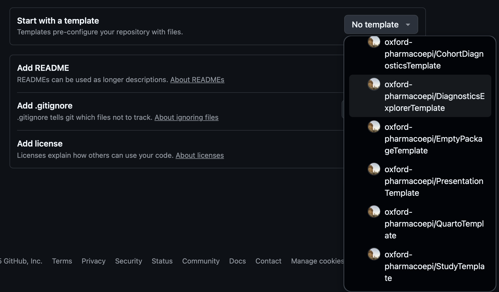{fig-align="center"}

## You are ready

. . .

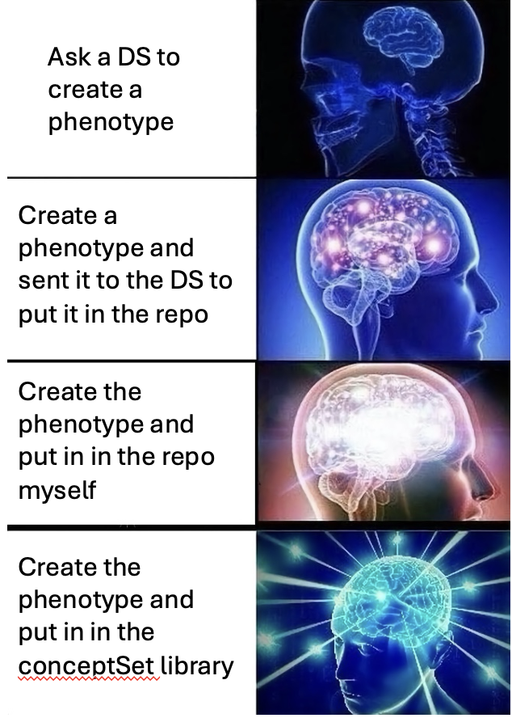{fig-align="center"}
