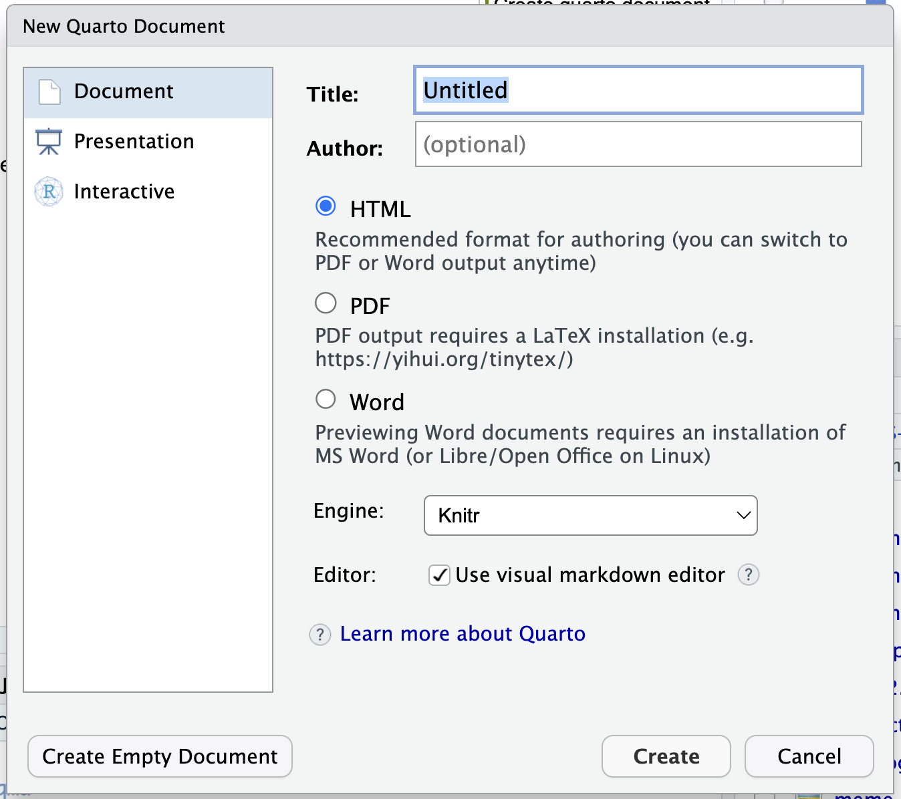

## Quarto

Quarto is a free tool for creating documents from a plain-text source file. You can combine writing, code, and the results of that code in one place.

Use the same source to create reports, presentations, websites, and more. Quarto works with R, Python, Julia, and Observable.

In this training we will use **R**.

## What happens when you render?

You write your content in a `.qmd` file. When you render it, Quarto runs the code, adds its output to your writing, and creates the finished document.

That makes it easier to update a report when the data changes: update the data, render again, and the numbers and figures are refreshed from the code.

## How to create a Quarto document

Open the R Project you created earlier. In RStudio, choose **File → New File → Quarto Document…**.

Give the document a name and save it inside your project. Keeping the document and its data together makes it easier to find and share your work.

## Create a Quarto document

{fig-align="center"}

## Choose a format and render

Start with **HTML** and click **Render**. Quarto will create a document you can open in your browser.

- Try rendering the same source as Word and PDF, then compare the results.
- For the template exercise, switch the output format to Word.

. . .

The writing and code stay in the `.qmd` source. You can render it again whenever you update the content or data.

## Parts of a Quarto document

A `.qmd` file has two main parts:

- **Metadata** at the top, between lines containing `---`. This is YAML and stores settings such as the title and output format.
- **Document body** below the metadata. This contains your text, headings, code, and other content to render.

## Write some text

Quarto uses Markdown for headings and basic formatting. For example:

```markdown
# Main heading
## Smaller heading

This is a paragraph with **bold text**.

- This is a list item.
- And another one.
```

. . .

Render the document and see how the source becomes a formatted page.

## Add some code

Put R code in a code chunk. Quarto can run it and include the result in the document:

```{r}
scores <- c(7, 8, 10)
mean(scores)
```

. . .

The code and its result are connected: change the values and render again to update the result.

## `echo`, `eval`, `messages`, and `warnings`

These options control what happens to code chunks:

- `echo`: show (`TRUE`) or hide (`FALSE`) the code in the rendered document.
- `eval`: run (`TRUE`) or skip (`FALSE`) the code.
- `message` and `warning`: show or hide messages and warnings produced by the code.

. . .

Set options in the chunk header, or set document-wide defaults in the YAML under `execute:`. For example, a chunk with `{r, echo=FALSE, message=FALSE}` runs `summary(scores)` but hides its code and messages while showing the result.

. . .

You can also change this options globaly with the initial block of yaml file, the following block for example will make all the code to be hidden but executed:

```text
---
execute:
  echo: false
  eval: true
---
```

## `YOUR TURN`

1. Open the course website’s **Downloads** tab and choose your GitHub username.
2. Click **Download Data 1 results** and save `data1.csv` in a `data` folder inside your R Project.
3. Read it into your Quarto document. Add a sentence, table, or plot that tells us something about the data.

## `YOUR TURN` Read, summarise, and plot

Read the CSV with `readr`, then find the row with the highest prevalence:

```{r, eval=FALSE}
library(readr)
library(here)
library(dplyr)
data <- read_csv(here("data", "data1.csv"))
highest_example <- data |>
  filter(prevalence == max(prevalence))
```

In your document, you could write this sentence using inline R:

```{=html}
<pre><code>The highest prevalence is &#96;r highest_example$prevalence&#96;
for &#96;r highest_example$condition&#96;
in &#96;r highest_example$database&#96; in &#96;r highest_example$year&#96;.</code></pre>
```

For example, you could describe the highest value in a sentence, make a table, or plot prevalence by year and condition.

These chunks are examples for your own document.

```{r, eval=FALSE}
library(ggplot2)
ggplot(data, aes(x = year, y = prevalence, colour = condition)) +
  geom_point() +
  facet_wrap(~database)
```

Inline R expressions run when you render the document, just like code in a chunk.

## Spacing in Quarto

Leave a blank line in the source to start a new paragraph. A single newline in the source may still appear as part of the same paragraph when rendered.

In a presentation, a new `##` heading starts a new slide. Keep headings short so the audience can see the main point at a glance.

## Use templates

A template gives documents a shared look and saves you from formatting every report by hand. For a Word report, a reference document can define headings, fonts, spacing, headers, footers, and caption styles.

Quarto uses the content and styles in your `.qmd` file; Word uses the matching styles in the reference document to decide how those parts look.

## Example of a Word template

The [darwinReportRef.docx template](https://github.com/darwin-eu/visOmopResults/blob/main/inst/quarto/darwinReportRef.docx) is an example of a Word reference document.

Download it and open it in Word to explore the styles. In your Quarto document, set it as the `reference-doc` for Word output, then render the report to apply those styles.

For example, save the template in your project folder and add this to the document YAML:

```yaml
format:
  docx:
    reference-doc: "darwinReportRef.docx"
```

## Custom styles for captions

You can give a block of text a style name that exists in the Word reference document:

```markdown
:::{custom-style="FigureCaption"}
Figure 1. The prevalence of the different condition over time.
:::

:::{custom-style="CaptionFooter"}
CI = confidence interval
:::
```

Create or change the `FigureCaption` and `CaptionFooter` styles in the Word template to control their appearance. The style names in the document and template need to match.

## `YOUR TURN`

A new data partner sends updated results at the last minute, and two other partners have updated their old results. No need to rebuild the report by hand:

1. In your username tab on **Downloads**, click **Download Data 2 results** and save `data2.csv` in your `data` folder.
2. Update your `read_csv()` line to read `data2.csv`.
3. Render the Quarto document again and compare the results.

. . .

The report is refreshed from the new data. Check what changed for SIDI Plata, notice the new SIDI Or results, and confirm that SIDI Bronze stayed the same.

## Final remarks

- Keep the writing, code, and results together in the `.qmd` source.
- Use a template when reports need a consistent look.
- When the data changes, update the input files and render again.

. . .

That’s Quarto: write it once, render it when you need it, and let the code update the results.
